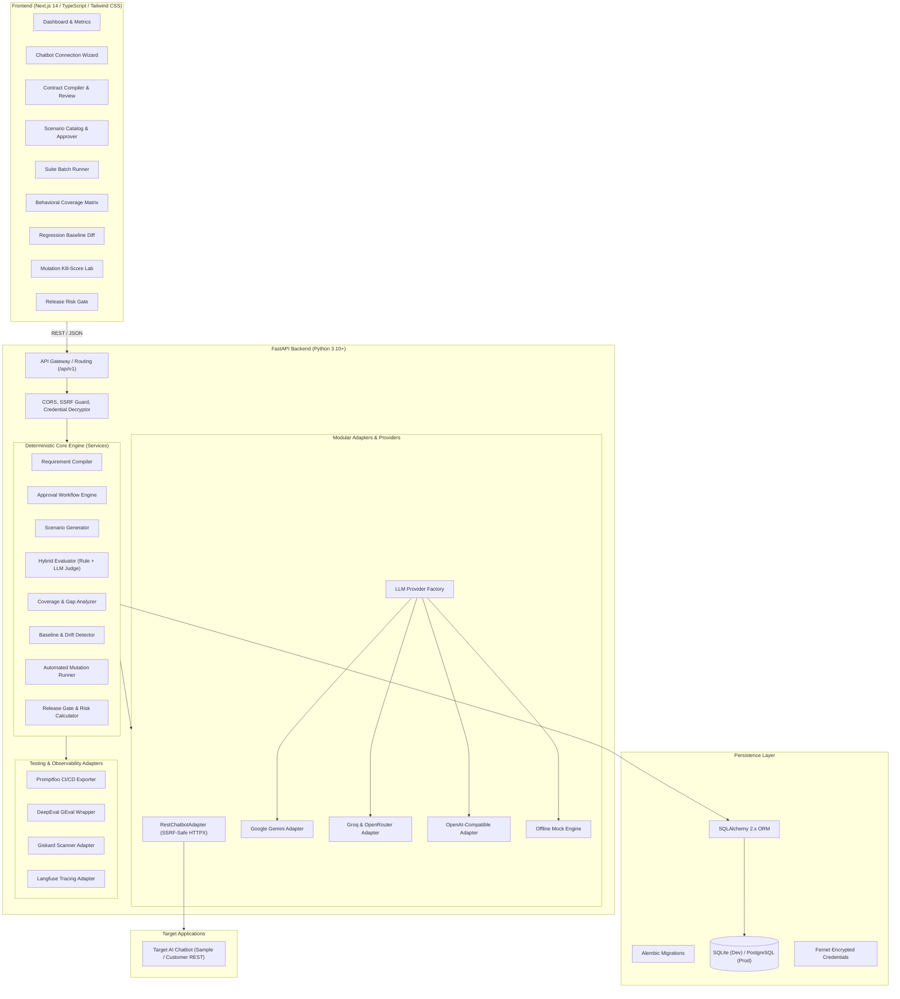
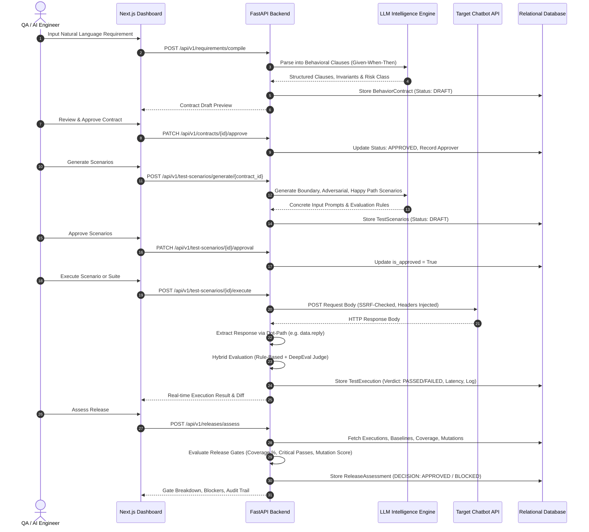

# AI TestBench — System Architecture & Design Specification

AI TestBench is a behavior-first AI assurance and release readiness platform designed to evaluate AI chatbots, conversational agents, and LLM applications against rigorous, human-approved behavioral contracts.

---

## 1. High-Level System Architecture

AI TestBench adopts a **modular monolith** design pattern on the backend and a reactive Next.js 14 Single-Page Application on the frontend. The deterministic evaluation core coordinates test orchestration, while modular adapters interface with external LLM reasoning engines, REST chatbots, and observability ecosystems.



---

## 2. Modular Monolith Architecture

The backend repository is organized into distinct functional domains, maintaining clear boundaries and loose coupling.

```
TestBench-main/
├── alembic/                      # Database migration scripts & environment
│   └── versions/                 # Versioned migration histories
├── app/
│   ├── adapters/                 # Target system communication adapters
│   │   ├── __init__.py
│   │   └── chatbot_adapter.py    # RestChatbotAdapter with SSRF protection
│   ├── api/                      # Presentation layer / REST endpoints
│   │   ├── __init__.py
│   │   └── routes.py             # FastAPI routes for all modules
│   ├── integrations/             # Third-party testing & observability tools
│   │   ├── __init__.py
│   │   ├── availability.py       # Integration registry matrix
│   │   ├── deepeval_integration.py
│   │   ├── giskard_integration.py
│   │   ├── langfuse_integration.py
│   │   └── promptfoo_integration.py
│   ├── llm/                      # Multi-provider LLM abstraction
│   │   ├── __init__.py
│   │   ├── base.py               # Abstract LLMProvider base class
│   │   ├── factory.py            # Dynamic provider instantiation
│   │   ├── gemini_provider.py    # Google Gemini REST integration
│   │   ├── groq_provider.py      # Groq / OpenRouter integration
│   │   ├── openai_provider.py    # OpenAI compatible integration
│   │   └── deterministic_mock_provider.py # Zero-dependency offline engine
│   ├── config.py                 # Pydantic v2 application settings
│   ├── database.py               # SQLAlchemy engine & session factory
│   ├── main.py                   # FastAPI entrypoint, middleware, CORS
│   ├── models.py                 # SQLAlchemy 2.0 ORM relational models
│   ├── schemas.py                # Pydantic v2 request/response schemas
│   ├── security.py               # Fernet encryption & SSRF validation
│   └── services.py               # Core business logic & deterministic algorithms
├── sample_chatbot/               # Real target customer-support chatbot
│   ├── app.py                    # Standalone FastAPI sample server
│   └── README.md
├── tests/                        # Automated unit, integration, and e2e tests
│   ├── test_enhanced_platform.py
│   ├── test_integrations.py
│   ├── test_platform.py
│   └── test_sample_chatbot.py
├── alembic.ini                   # Alembic configuration
├── requirements.txt              # Production backend dependencies
└── requirements-integrations.txt # Optional data science & evaluation tools
```

---

## 3. Core Traceability Pipeline

A central requirement of AI TestBench is end-to-end traceability. Every release decision is mathematically grounded in execution logs that link back to human-approved behavior contracts.



---

## 4. Multi-Provider LLM Integration Architecture

AI TestBench does not lock developers into a single LLM vendor. The LLM abstraction layer provides a unified interface:

```python
class LLMProvider(ABC):
    @abstractmethod
    def generate(self, prompt: str, system_prompt: Optional[str] = None, temperature: float = 0.0) -> str:
        """Execute text generation against the configured provider."""
        pass
    
    @abstractmethod
    def is_available(self) -> bool:
        """Check provider operational status and API key readiness."""
        pass
```

### Provider Matrix:
1. **Google Gemini**: Uses native REST endpoints against `gemini-1.5-pro` and `gemini-1.5-flash` with direct JSON parsing.
2. **Groq**: Uses Groq's high-speed inference endpoints (`llama-3.3-70b-versatile`, `mixtral-8x7b-32768`).
3. **OpenRouter**: Accesses unified open-source and commercial foundation models over OpenAI-compatible endpoints.
4. **OpenAI**: Connects to `gpt-4o`, `gpt-4o-mini`, or any internal OpenAI-compatible gateway (vLLM, Ollama, LocalAI).
5. **Deterministic Mock Engine**: Zero-configuration offline intelligence engine with semantic rule-based heuristics that guarantees 100% test reproducibility without external API keys or cloud dependencies.

---

## 5. Security Architecture

### 5.1 SSRF (Server-Side Request Forgery) Guard
When communicating with user-configured chatbots, AI TestBench enforces strict network boundary protections:
- **Protocol Whitelisting**: Only `http://` and `https://` schemes are accepted.
- **DNS Resolution & IP Inspection**: Resolves hostnames to IP addresses prior to request dispatch.
- **Private & Loopback Blocking**: Automatically blocks IPv4 private ranges (`10.0.0.0/8`, `172.16.0.0/12`, `192.168.0.0/16`), loopback addresses (`127.0.0.0/8`, `::1`), link-local (`169.254.0.0/16`), and carrier-grade NAT (`100.64.0.0/10`).
- **Cloud Metadata Protection**: Explicitly blocks `169.254.169.254` (AWS/GCP/Azure metadata endpoints).
- **Development Flag**: `ALLOW_PRIVATE_CHATBOT_HOSTS=true` allows trusted local testing (e.g. testing against `http://localhost:8001`) during development only.

### 5.2 Secret Encryption at Rest
- Sensitive credentials (API keys, Bearer tokens) are encrypted before writing to SQLite or PostgreSQL using **Fernet symmetric cryptography** (AES-128-CBC with SHA256 HMAC).
- When retrieving chatbot records via API endpoints, credentials are never returned in plaintext. The API returns `has_credential: true` and masks values to prevent credential harvesting.

---

## 6. Release Assessment & Gating Engine

Release risk is computed deterministically rather than delegated to probabilistic LLM judgment:

$$\text{Release Ready} = (\text{Coverage} \ge \tau_{\text{cov}}) \land (\text{Pass Rate} \ge \tau_{\text{pass}}) \land (\text{Critical Failures} = 0) \land (\text{Regressions} = 0) \land (\text{Mutation Score} \ge \tau_{\text{mut}})$$

Where default production thresholds are:
- Minimum Behavioral Coverage: **80.0%**
- Minimum Test Pass Rate: **90.0%**
- Allowed Critical Failures: **0**
- Allowed Regressions: **0**
- Minimum Mutation Kill Score: **70.0%**
